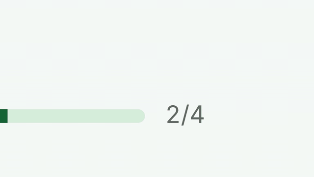
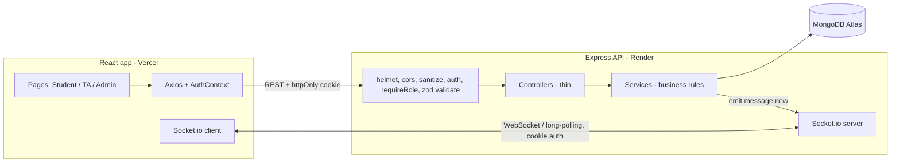

# VivaTrack

## Demo



▶ [Watch the full walkthrough with voiceover (3:50)](docs/demo/vivatrack-demo-720p.mp4)
&nbsp;·&nbsp; Live app: [vivatrack-two.vercel.app](https://vivatrack-two.vercel.app)

## Problem Statement

Lab sessions at our college run per course (e.g. a MERN course has 6 sessions). Students give **in-person vivas** to TAs, and management pre-assigns a fixed set of students to each TA. If the course is currently at session 4, a student can give vivas for sessions 1–4, never 5 or 6. The vivas happen offline; there is no single reliable place for the marks and attendance, no way to flag struggling students, no private channel to report a TA problem, and no direct line between a student and their TA.

## Target Users

| Role | What they need |
| --- | --- |
| **Student** | See own marks / attendance per session, message their assigned TA, privately report a TA problem |
| **TA** | Record marks and attendance for *their* assigned students, flag students who need attention, chat with mentees |
| **Admin** (management / instructor) | Manage courses and sessions, assign students to TAs, see what is pending, export grades, handle issues and flags |

## Solution

VivaTrack is the record-keeping and communication layer around the offline vivas. Every rule (session unlocking, assignment scope, marks limits, privacy) is enforced **on the backend**; the UI only reflects it.

## Key Features

- JWT auth in an httpOnly cookie; role-based access (student / TA / admin); deactivated users cannot log in
- Courses with session control: advance / set the current session, never above `totalSessions`; lowering is blocked while records exist above it
- Assignment CSV import (row-by-row results: created / skipped / error rows) and manual TA reassignment
- TA grading: per-session student list with status, progress bar, search and filter; grading drawer with attendance, marks, remarks and a full **edit history** (audit log)
- Student dashboard: per-session status, marks, attendance %, pending sessions, locked future sessions greyed out
- **Live student ↔ TA chat** (headline feature): Socket.io for live delivery, REST as the source of truth, optimistic sending with retry that can never duplicate, catch-up after reconnect, pagination, date separators, TA inbox that updates live
- Attention flags (TA / admin only — never visible to the student)
- Private issue reporting (student ↔ admin only — TAs have zero access)
- Admin pending report (grouped by TA) and grades CSV export (properly escaped)

## Tech Stack

Node.js, Express 4, Mongoose, MongoDB (Atlas) · React (Vite), React Router, Axios, Tailwind CSS 4 · JWT + bcrypt · Socket.io · zod · helmet, cors, express-rate-limit, express-mongo-sanitize · Jest + Supertest + mongodb-memory-server · multer + csv-parse (CSV import).

## Architecture



**Server layout:** `routes/` (wiring + zod schemas) → `controllers/` (HTTP only) → `services/` (all business rules) → `models/`. Errors go through one `errorHandler` that returns `{ error: { code, message, details? } }`.

**Authorization model.** The role comes from the authenticated user (re-read from the DB on every request, never trusted from the token). *Who may touch whom* comes only from the **Assignment** collection (`course + student + ta`, unique per `(course, student)`). Client-supplied `ta`, `student` or `sender` values are never trusted:

- TA → records / flags / chat only for students assigned to them **for that course** (403 otherwise)
- Student → only their own records, issues and chat with their own TA
- Admin → management routes; no chat access
- Issues → admin and the reporting student only; the `ta` field is derived from the student's assignment; TAs get 403 on every issue route and no other response mentions issues

**Main business rules** (in `server/src/services/`)

1. A viva can only be recorded for `sessionNumber <= course.currentSession` (400 otherwise).
2. `currentSession` ∈ [0, `totalSessions`]; lowering needs no records above the new value (409).
3. TA scope is by Assignment for that course (403).
4. `0 <= marks <= maxMarksPerViva`; absent ⇒ marks must be empty; present ⇒ marks required.
5. One record per `(course, student, session)`; duplicates → 409 (unique index; `11000` is translated centrally).
6. Every create/update writes an AuditLog with old/new values; a no-op update writes nothing and returns 200.
7. Students cannot see flags about themselves; duplicate active flags → 409.
8. Chat only between currently assigned pairs; old conversations stay readable (read-only) by both original parties after a reassignment.

## Local Setup

Prerequisites: Node 18+ and a MongoDB (local or an Atlas free cluster).

```bash
# 1. Server
cd server
cp .env.example .env          # then edit MONGO_URI and JWT_SECRET
npm install
npm run seed                  # wipes + recreates the demo data (only when you run it)
npm run dev                   # http://localhost:5000

# 2. Client (new terminal)
cd client
cp .env.example .env
npm install
npm run dev                   # http://localhost:5173
```

To try chat, open two browser sessions (e.g. a normal and a private window): log in as `student1@demo.test` in one and `ta1@demo.test` in the other and message each other.

## Troubleshooting (friend's laptop / different network)

1. **Fresh install** – do `npm install` in both `server` and `client` on *your own* machine. Never copy `node_modules` between computers (native packages differ per OS).
2. **DNS / `querySrv ECONNREFUSED`** – `mongodb+srv://` needs DNS SRV lookups, which some Wi-Fi / college / ISP DNS servers block. The server now retries automatically with public DNS (8.8.8.8). If it still fails: run `npm run mongo:uri` (in `server`) on a network where it works and paste the printed non-SRV `mongodb://...` URI into `MONGO_URI`, **or** switch the laptop DNS to `8.8.8.8` / `1.1.1.1`, **or** use a phone hotspot.
3. **Atlas "IP not whitelisted"** – in MongoDB Atlas > Network Access add the laptop's IP (or `0.0.0.0/0` for a demo).
4. **Port 5173/5000 already in use** – change `PORT` (server) / `--port` (Vite) and keep `CLIENT_URL` and `VITE_API_URL` in sync. `CLIENT_URL` must exactly match the address in the browser (`localhost`, not `127.0.0.1`).
5. After the first successful start, load demo data once with `npm run seed` (it wipes and recreates the data). With `NODE_ENV=production` the seed refuses to run unless you also set `SEED_CONFIRM=wipe`.

## Environment Variables

**Server (`server/.env`)**

| Variable | Purpose |
| --- | --- |
| `PORT` | HTTP port (default 5000; Render sets it automatically) |
| `MONGO_URI` | MongoDB connection string |
| `JWT_SECRET` | Long random string used to sign tokens (required in production) |
| `JWT_EXPIRES_IN` | Token lifetime, e.g. `7d` |
| `CLIENT_URL` | Exact frontend origin, e.g. `https://your-app.vercel.app`. Used for CORS **and** Socket.io CORS (credentials on) |
| `NODE_ENV` | `development` / `production` / `test` |
| `TRUST_PROXY` | Proxy hops in front of the API (1 = Render only, 2 = Render + Vercel proxy) |
| `DISABLE_RATE_LIMIT` | `true` turns off login/chat rate limits (local testing only) |
| `SEED_PASSWORD` | Password given to every seeded demo user |

**Client (`client/.env`)**

| Variable | Purpose |
| --- | --- |
| `VITE_API_URL` | Backend base URL for **local development only** (production uses the Vercel proxy) |
| `VITE_SHOW_DEMO_HINT` | `true` shows the demo logins on the login page |

## Demo Accounts

Created by `npm run seed`. **Demo only.** Password = `SEED_PASSWORD` (default `Demo@1234`).

| Role | Email |
| --- | --- |
| Admin | `admin@demo.test` |
| TA | `ta1@demo.test` (students 1–4), `ta2@demo.test` (students 5–8) |
| Student | `student1@demo.test` … `student8@demo.test` |

Seeded course: **MERN Stack (MERN101)**, 6 sessions, currently at session 4, 10 marks per viva. It includes complete / absent / missing records, one active flag (student3), one open issue (student4) and a chat history across three student–TA pairs.

## Testing

```bash
cd server
npm test
```

Uses Jest + Supertest + mongodb-memory-server (an in-memory MongoDB, no setup needed; it reuses a cached `mongod` binary from `~/.cache/mongodb-binaries` if present so it also works offline). 30 tests cover: assignment scope (403), locked sessions (400), marks rules, duplicates (409) and audit logging, student privacy, TA blocked from all Issue endpoints, role isolation (401/403), the complete chat rule set (unassigned pairs, spoofed sender, length limits, idempotent `clientMessageId`, `before`/`after` pagination, archived conversations after reassignment, unauthenticated sockets rejected, a socket only receives its own `message:new`), session control, flags, issues, pending report, CSV export escaping and CSV import with mixed valid/invalid rows.

## Deployment

Live links: Frontend **<https://vivatrack-two.vercel.app>** · Backend **<https://vivatrack-api.onrender.com>** · Database: MongoDB Atlas.

1. **MongoDB Atlas** – create a free cluster and a DB user. In *Network Access* allow Render to connect (simplest for a demo: `0.0.0.0/0`; Render's free tier has no fixed IPs). Copy the connection string.
2. **Backend on Render** – new *Web Service* from this repo, root directory `server`, build `npm install`, start `npm start`, health check path `/health`. Set `MONGO_URI`, `JWT_SECRET`, `CLIENT_URL` (the Vercel URL), `NODE_ENV=production`, `JWT_EXPIRES_IN`. Run `npm run seed` once from the Render shell (or locally with the Atlas URI) to load demo data.
3. **Frontend on Vercel** – import the repo, root directory `client`, framework Vite. Set `VITE_API_URL` to the Render URL (and `VITE_SHOW_DEMO_HINT=true` if you want the hint). `client/vercel.json` rewrites all paths to `index.html` so React Router deep links work.

**Cookies and the Vercel proxy.** Vercel and Render are different sites, so a cookie set directly by Render would be a *third-party* cookie that Safari, Firefox and incognito windows block. To avoid that, the production client always calls **same-origin** paths (`/api/...`, `/socket.io/...`) and `client/vercel.json` rewrites those to the Render URL. The browser therefore only ever talks to the Vercel domain and the auth cookie is first-party (still `HttpOnly; Secure`, set in `server/src/utils/token.js`). Consequences: `VITE_API_URL` is only used in development; if your Render service has a different URL, edit the two `destination`s in `client/vercel.json`. Vercel cannot tunnel WebSockets, so in production Socket.io uses long-polling (still live, just HTTP). The server still calls `app.set('trust proxy', env.trustProxy)`; set `TRUST_PROXY=2` on Render (Render's proxy + Vercel's) so rate limits see real client IPs. CORS stays locked to `CLIENT_URL` for any direct calls.

**Cold starts.** Render's free tier sleeps when idle, so the first request and the first socket connection can take 30–60 s. The UI shows "Connecting…/Reconnecting…" meanwhile and REST sending keeps working.

> Not verified in this build: the live Vercel ↔ Render deployment (including Socket.io with cookies across the two origins). Everything else was run locally; please confirm chat connects once deployed.

## Design Decisions

- **Socket.io for live delivery, REST as the source of truth.** History, pagination and sending all go through REST; the socket only pushes `message:new`. If the socket is down nothing breaks – the thread just stops being live until it reconnects.
- **Send via REST, not via the socket.** Authorization, zod validation, rate limiting and the idempotency check live in exactly one place. After saving, the server emits to `user:<studentId>` and `user:<taId>`.
- **Private rooms only.** The handshake is authenticated from the httpOnly cookie; each socket joins only `user:<its own id>`. There are no client-driven join events, so there is nothing to abuse.
- **Idempotent sends.** The client generates a UUID `clientMessageId`; `(sender, clientMessageId)` is unique. A retry returns the existing message with 200 and emits nothing, so an ambiguous network failure can never create a duplicate. The UI dedupes by `clientMessageId` and `_id`, so the optimistic copy, the REST response and the socket event all collapse into one bubble.
- **Catch-up on reconnect.** Every socket `connect` triggers `GET /chat/messages?after=<last createdAt>` for the open thread; the Reconnecting banner is shown meanwhile.
- **Reassigned students.** The old conversation stays readable (read-only, marked archived) for both original parties; new messages are only allowed with the current TA.
- **Business rules in services**, controllers are thin, one error handler, one validation middleware (zod).
- **`PUT /ta/records` is an upsert**, as specified. The strict "create, duplicate ⇒ 409" lives in `recordService.createRecord`; concurrent first writes are stopped by the unique index and surface as 409. There is no separate POST route (not in the spec).
- **Validation errors are 400** (`VALIDATION_ERROR` with per-field `details`) rather than 422.
- **`bcryptjs`** instead of native `bcrypt`: identical hashing (cost 10), no native build step on Render.
- **CSV exports** prefix cells that start with `= + - @` with an apostrophe to prevent spreadsheet formula injection.
- **Rate limits:** login 10 / 15 min per IP; chat send 60 / min per user (both skipped when `NODE_ENV=test`).
- **Attendance %** = present sessions ÷ unlocked sessions; pending sessions count as not attended.
- **TA progress `done/total`** counts any recorded viva (present or absent) as handled.

## Limitations and Future Work

- No read/delivered receipts, typing indicators, attachments, unread counts or push notifications (deliberately out of scope).
- No UI for deactivating users or for admins to raise flags (the admin flag API exists; only list/resolve is in the UI).
- No password reset / change-password flow; admin sets temporary passwords.
- Chat messages are plain text only and limited to 1000 characters; archived conversations after reassignment cannot be continued.
- Single-instance Socket.io; scaling to several server instances would need the Redis adapter.
